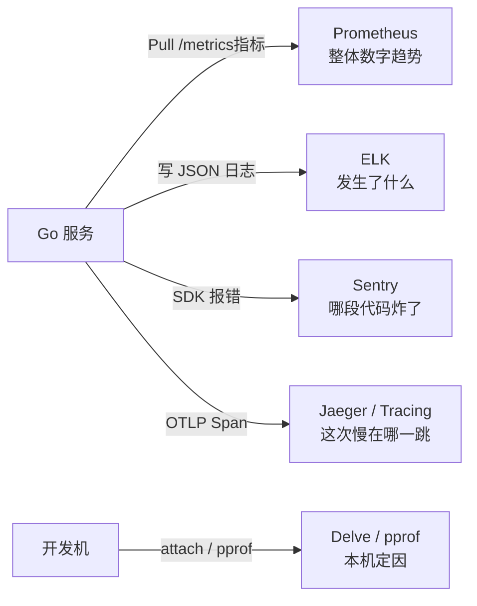
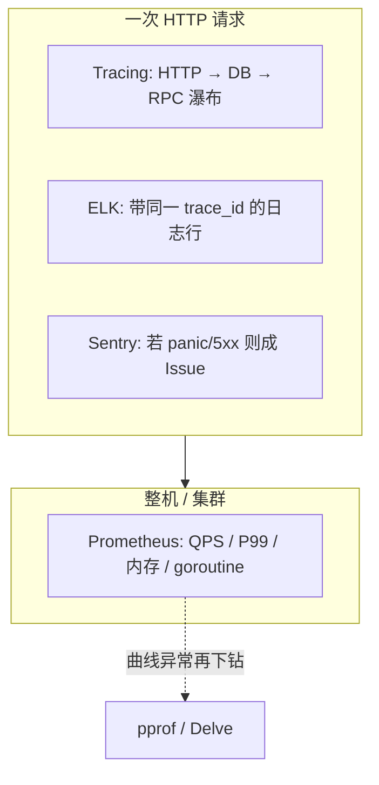

# 8. 复盘：Prometheus / ELK / Sentry / Tracing（+ Delve/pprof）

## 目标

形成稳定心智模型，知道线上排障先开哪扇门。

## 一张图先建立心智

**各自回答什么问题：**



**同一请求上，数据怎么叠在一起：**



**选型口诀：** 先看 **有没有异常曲线（Prom）** → 再看 **是慢还是炸（Tracing / Sentry）** → 再用 **日志补上下文（ELK）** → 需要源码级定因才上 **pprof / Delve**。

## 对照表

| | Prometheus | ELK | Sentry | Tracing (OTel/Jaeger) | Delve / pprof |
|--|------------|-----|--------|------------------------|----------------|
| 主数据 | **时序指标**（具体见下） | 日志文本 | 错误事件 | Trace / Span 时间线 | 进程调试 / 性能剖析 |
| 采集 | Pull `/metrics` | Push 日志 | SDK 上报错误 | OTLP 导出 | 本机 attach / HTTP pprof |
| 典型问题 | 内存 / goroutine 是否持续涨？ | 某请求日志写了什么？ | 哪个函数 panic？ | **这次请求慢在哪一段？** | 断点看栈；heap 定因 |
| 本仓库命令 | `make prom-up` | `make elk-up` | `make sentry-boom` | `make jaeger-up` + `trace-demo` | `dlv` / `make pprof-top` |

### Prometheus 时序指标（本仓库实际暴露）

来源：`promhttp.Handler()` → `:8000/metrics`（client_golang 默认 **Go + process** collector）。  
泄漏实验优先盯加粗项。

| 类别 | 指标名 | 看什么 |
|------|--------|--------|
| **协程** | **`go_goroutines`** | 当前 goroutine 数；leak worker 挂着会明显高于基线 |
| | `go_threads` | OS 线程数；通常不如 goroutine 敏感 |
| **堆内存** | **`go_memstats_heap_alloc_bytes`** | 堆上仍被引用的字节；**泄漏时持续上扬（首选）** |
| | `go_memstats_heap_inuse_bytes` | 堆 in-use（含未归还 OS 的 span） |
| | `go_memstats_heap_sys_bytes` | 堆从 OS 要到的字节；长期涨=系统侧内存变多 |
| | `go_memstats_heap_idle_bytes` / `go_memstats_heap_released_bytes` | 空闲 / 已归还 OS 的堆 |
| **分配速率** | **`go_memstats_alloc_bytes_total`** | 累计分配（含已回收）；用 `rate(...[1m])` 看每秒分配 |
| | `go_memstats_mallocs_total` / `go_memstats_frees_total` | malloc/free 次数 |
| **GC** | `go_gc_duration_seconds` | GC 停顿耗时；分配狂飙时会变忙 |
| | `go_memstats_next_gc_bytes` | 下次 GC 目标堆大小 |
| **进程** | `process_resident_memory_bytes` | 进程 RSS（物理内存体感） |
| | `process_virtual_memory_bytes` | 虚拟内存 |
| | `process_cpu_seconds_total` | 累计 CPU；本 demo 次要 |
| | `process_open_fds` / `process_max_fds` | 打开 fd / 上限 |

**本仓库实验常用 PromQL（与 [4plan-prometheus](./4plan-prometheus.md) 一致）：**

```promql
go_goroutines
go_memstats_heap_alloc_bytes
rate(go_memstats_alloc_bytes_total[1m])
```

说明：当前 demo **没有**自定义业务指标（如 `http_requests_total`、延迟 Histogram）。线上通常再加 **QPS / 延迟 P99 / 错误率**。Prometheus「看见涨了」≠ pprof「定因到 `leakWorker`」。

## 推荐排障顺序

**泄漏 / 资源涨：**

1. **Prometheus**：确认 `go_memstats_*`、`go_goroutines` 异常  
2. **pprof diff**：定位到函数（如 `leakWorker`）  
3. **Delve**：需要时打断点  

**单请求慢 / 调用链不清：**

1. **Tracing**：Jaeger 看 span 瀑布（DB？下游 RPC？）  
2. **ELK**：用同一 `trace_id` 搜日志上下文  
3. **Prometheus**：看整体 P99 / 错误率是否同步恶化  

**异常炸了：**

1. **Sentry**：Issue 聚合与堆栈  
2. **ELK / Tracing**：补齐前后请求上下文  

## 验收（自评）

- [ ] 能不看文档画出四条链路（Prom / ELK / Sentry / Tracing）
- [ ] 能举一个「只用错工具会怎样」的例子（例如只用 Kibana 查堆泄漏；或只用 Prometheus 查「慢在哪一跳」）
- [ ] 本仓库指标 / 日志 / 异常 / 追踪实验都至少完整跑过一遍

## 延伸（可选）

- Prometheus → Alertmanager；Grafana 面板
- Logstash 增强解析；日志强制带 `trace_id`
- 自建 Sentry；OTel Collector 统一接收再分流 Jaeger/Tempo
